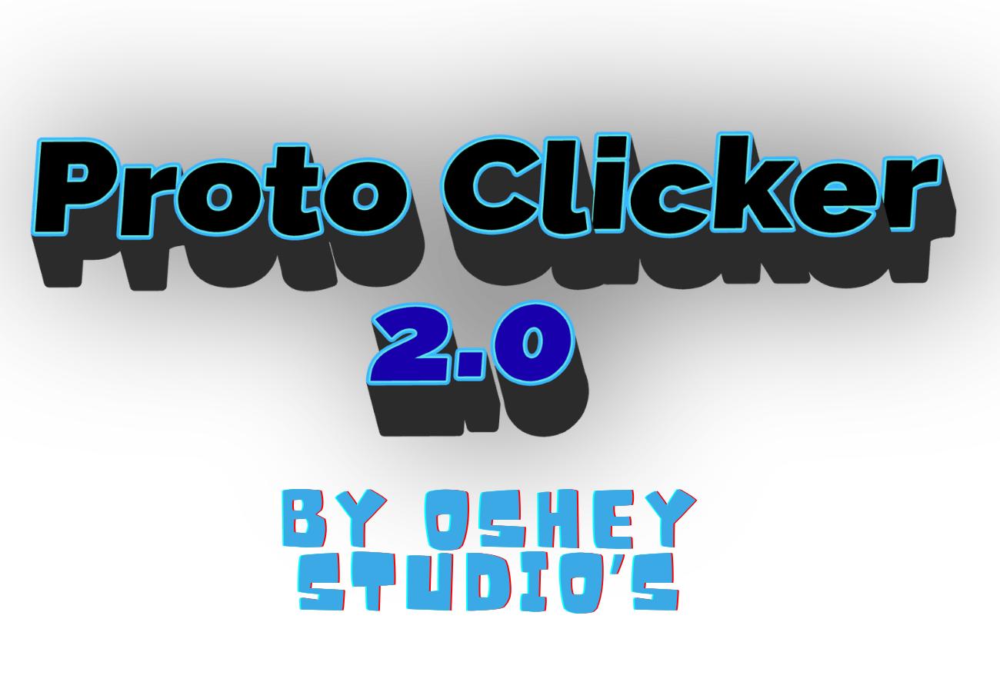

-------------
More (Content) Planed Updates (if I Continue to Update the game):
--------
**Update 1**:
- The Sacrifice Upgrade Tree (#7 -> #12)
- Tiers 13 - 15

**Update 2**:
- Recreation Tiers 1 -> 5
- Application Version of the Game

**Update 3**:
- Recreation Tiers 6 -> 10
- Final Reset (End of the game)

--------------
How to Play:
--------------

1st:  Have Somthing to Run Python on (Like Pycharm or Visual Studio)

2nd:  Make Sure to have the following installed
    - Python
    - Pygame
    - Pygame Community

3rd:  Press play and it should work

Link for Proto Clicker 1: https://studio.penguinmod.com/?fps=60&nohqpen&offscreen#7693053383

Note About the Game and Ai Usage are located in Notes.md

